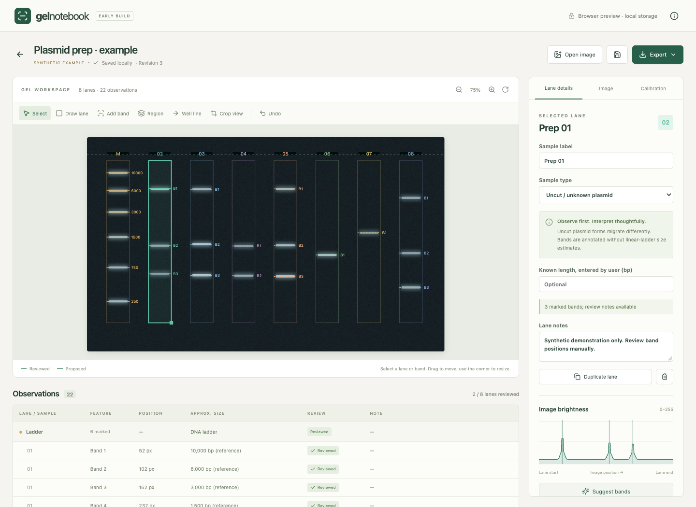
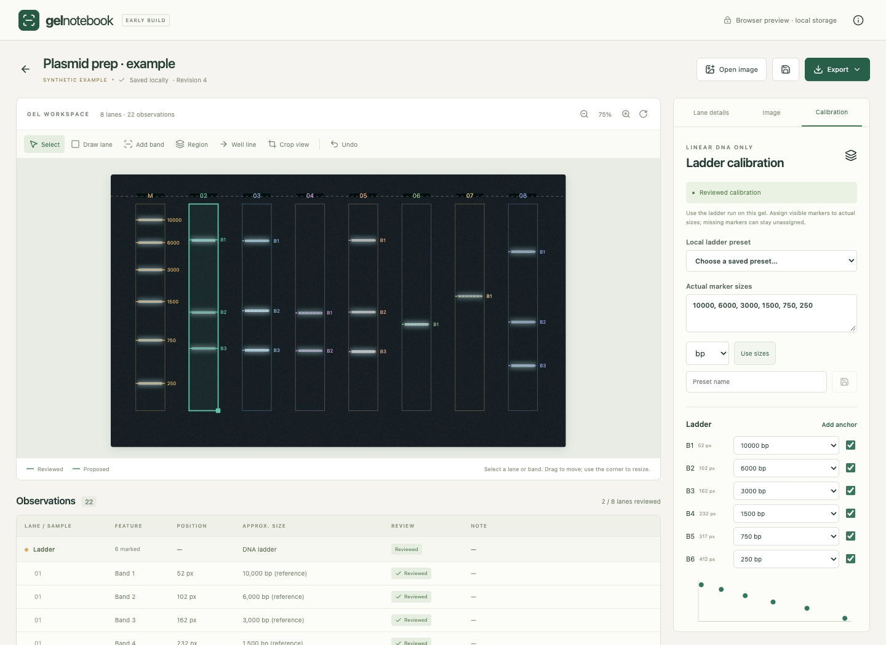

# Gel Electrophoresis Analyzer

A privacy-focused personal research-tool prototype for making gel electrophoresis images easier to interpret. The application is called **Gel Notebook** in its interface.

## Overview

Gel Electrophoresis Analyzer combines a gel image, editable lane and band annotations, a brightness profile, and an observations table in one local workspace. It helps organize visual review and compare eligible linear-DNA bands with a manually assigned, same-gel DNA ladder. It is an experimental portfolio project, not a validated scientific or medical product.

## Motivation

While working with molecular biology techniques, I noticed that interpreting and documenting gel electrophoresis images can involve repetitive visual analysis. I built this prototype to explore whether image-processing tools could make that workflow easier and more interpretable. The aim is to support a researcher's review and documentation; scientific judgment remains essential.

## Features

**Implemented**

- Import PNG/JPEG images, preserving their original bytes and a SHA-256 fingerprint; explore a generated synthetic example without supplying data.
- Manually draw, move, resize, duplicate, and delete lanes; add bands or unresolved regions, edit notes, and undo changes.
- View linked image overlays, lane brightness profiles, and an observations table with proposed/reviewed states.
- Adjust display contrast, zoom, quarter-turn rotation, and view cropping while retaining original analysis coordinates.
- Assign ladder sizes in bp/kb and save local marker presets.
- Autosave projects, reopen them, and recover one previous saved revision.
- Export annotated PNG images and spreadsheet-compatible CSV with lane summaries, notes, review status, and available size estimates.

**Implemented but experimental**

- Band suggestions from local peaks in a selected lane's brightness profile, with adjustable smoothing, prominence, and separation. Every suggestion requires review.
- Approximate linear-DNA sizing using piecewise interpolation in log₁₀(bp), with at least four ordered, reviewed ladder anchors and confirmed geometry. No extrapolation is performed.
- Expected-size window comparisons for eligible linear DNA. Agreement in size does not establish sequence identity.

**Planned / not implemented**

Automatic lane detection, automatic ladder matching, perspective/curvature correction, validated intensity quantification, TIFF import, and batch processing. These are possible next steps, not current capabilities.

## Privacy

The project was designed with privacy in mind. **All image processing is performed locally on the user's device, and images are not intentionally transmitted to external servers.** This describes the inspected application code: it has no upload service, account system, remote processing, analytics, or update integration. The packaged app restricts resource loading with a Content Security Policy. Comprehensive native network-observation testing remains pending; this is not a security certification.

The desktop app saves to its operating-system application data folder. Browser development mode uses IndexedDB on the local development origin. Projects contain original image bytes (which may retain embedded metadata), filenames, labels, and notes. Local storage is not additional encryption; exports and device backups are outside the app's control. Deleting a project does not delete separately exported files or backups.

Only synthetic demo content is included here. Keep real images, saved projects, research notes, and exports outside the repository. `.gitignore` excludes common data, credential, and build formats, but cannot recognize every sensitive filename or piece of text. See [privacy and publication review](docs/PRIVACY_REVIEW.md).

## How It Works

```text
PNG/JPEG image
    ↓
Local image decoding + original-image fingerprint
    ↓
Manual lane selection
    ↓
Lane brightness profile → optional peak suggestions
    ↓
Manual band/region annotation + review
    ↓
Optional reviewed ladder calibration for eligible linear DNA
    ↓
Local project + annotated PNG / CSV
```

Brightness is a weighted RGB average across each lane. Peak suggestions use smoothing, a local baseline subtraction, a prominence threshold, and minimum separation. Display adjustments do not change the pixels used for analysis. Uncut/unknown plasmids receive annotations only; linearized plasmids require explicit confirmation of a full-length single-cut product before sizing. See [engineering notes](docs/ENGINEERING.md).

## Screenshots

These are actual browser-preview screenshots of the built-in, entirely synthetic example. No laboratory images are used. The desktop and browser interfaces share the same frontend; their storage adapters differ.





Screenshot provenance and reproduction instructions: [screenshots](docs/assets/screenshots/README.md).

## Installation

For the browser development preview, install **Node.js 22 or newer** and npm, then run from the repository root:

```sh
npm ci
npm run dev
```

Open the local URL printed by Vite (normally `http://127.0.0.1:1420`). Dependencies are downloaded during installation; the analysis itself runs locally.

For the macOS desktop application, also install stable Rust and the macOS developer tools described in [Tauri's prerequisites](https://v2.tauri.app/start/prerequisites/):

```sh
npm run desktop
```

To check and build:

```sh
npm test
npm run build
cargo test --locked --manifest-path src-tauri/Cargo.toml
npm run package
```

The current packaging configuration targets macOS `.app` and `.dmg` bundles in `src-tauri/target/release/bundle/`. Signing, notarization, and distribution on a fresh machine remain unverified. No installer or prebuilt binary is published in this repository. Windows/Linux packaging is not configured or verified.

## Usage

1. Launch the application and choose **Open example**, or **Open image** to select a local PNG/JPEG (up to 30 MB and 40 megapixels).
2. For an imported image, set source, band appearance, migration direction, and well line in the image settings. Confirm geometry only when appropriate.
3. Use **Draw lane** to specify each lane and choose its sample type in **Lane details**. Lanes default to uncut/unknown plasmid.
4. Use **Add band**, **Region**, or **Suggest bands** on the selected lane. Correct positions, add notes, and review observations.
5. For optional linear-DNA sizing, mark exactly one lane as **DNA ladder**, assign its actual marker sizes under **Calibration**, review at least four distinct ordered anchors, and confirm the same-gel mapping. Review eligible sample bands.
6. Mark each lane reviewed after inspecting it, including empty lanes. Use **Export** for annotated PNG or CSV. Incomplete analyses remain marked draft.

For a quick sizing demonstration, open the synthetic example, confirm the existing ladder assignments under **Calibration**, select the **PCR control** lane in the table, and mark its observations reviewed. Its approximate size is around 1,000 bp. The example is illustrative, not a validation standard.

## Limitations

- This is an experimental prototype; accuracy has not been established on representative real-world gels.
- Lane selection and ladder assignment are manual. Band suggestions can miss faint bands or pick artifacts; image quality, saturation, skew, and curved migration affect interpretation.
- Approximate sizes apply only within the reviewed ladder interval and to eligible reviewed, unambiguous linear-DNA bands. Uncut plasmids, unresolved regions, and uncertain digests are excluded.
- Brightness is not DNA quantity. No concentration, yield, purity, topology, or sequence identity is inferred.
- PNG exports preserve full original orientation rather than the current crop/rotation. Contrast is disclosed on the export.
- Native restart/recovery, network monitoring, accessibility, failure handling, and fresh-machine distribution need further testing. See the [validation record](docs/VALIDATION.md) for what has and has not been checked.

## Disclaimer

This project is an experimental educational/research software prototype. It is not a clinically validated diagnostic tool and should not be used as the sole basis for scientific, medical, or clinical decisions. Results should be verified by the researcher. This is a personal project and does not represent or imply endorsement by any research institution.

## Future Work

- Evaluate lane-detection proposals that remain manually correctable.
- Improve peak detection for faint bands and uneven backgrounds using synthetic benchmarks before authorized real-data evaluation.
- Explore assisted ladder matching while retaining explicit review and sizing exclusions.
- Add TIFF support, better annotation layout, keyboard access, and batch review.
- Extend native storage/recovery and export tests; measure uncertainty before making accuracy claims.

## Repository Guide

- `src/` — React/TypeScript interface, image processing, analysis, and storage adapters.
- `src-tauri/` — Rust desktop shell, scoped local storage, and native export dialog.
- `tests/` — synthetic calculation and review/export tests.
- `examples/` — safe built-in demo instructions.
- `docs/` — static GitHub Pages portfolio, screenshots, engineering notes, and review records.
- `scripts/` — publication checks and portfolio configuration.

The GitHub Pages site is a static project overview, not an image-upload service. See [publication instructions](docs/PUBLISHING.md) for repository metadata, exact upload steps, and Pages configuration.

## License

A project license has not yet been applied because ownership of all original code and artwork has not been independently established. MIT is recommended once the author confirms release rights. Dependencies retain their own licenses; see [dependency and ownership notes](docs/DEPENDENCIES.md). Public source visibility alone does not grant an open-source license.
